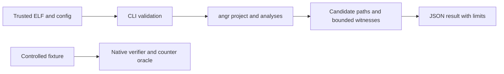
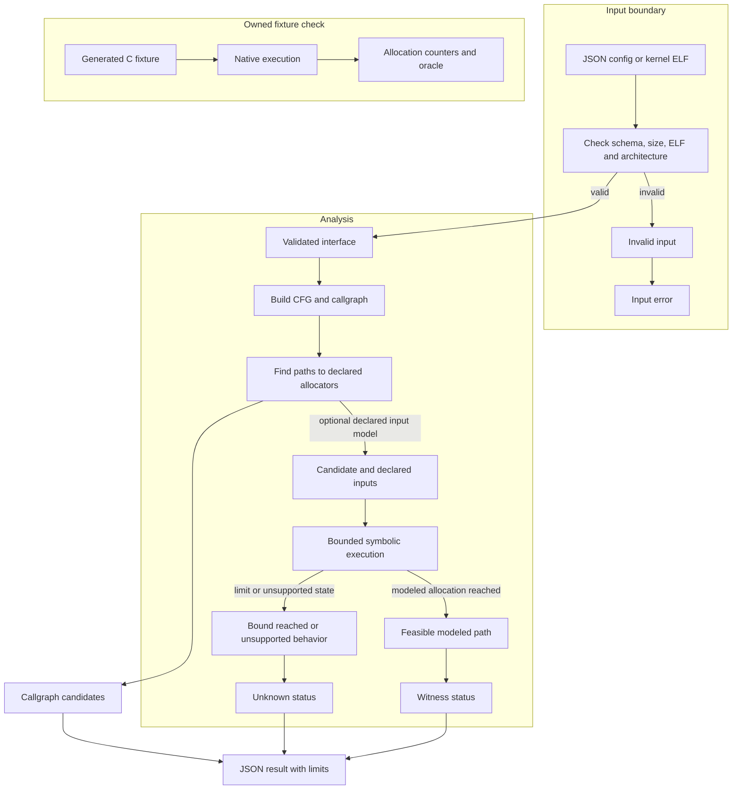

# Allocation Pattern Analyzer

Bounded static analysis for allocation-reaching paths in trusted ELF x86-64 programs, including Linux kernel images. The analyzer uses angr 9.2.207 to discover syscall and allocator symbols, index syscall-to-allocation callgraph candidates, and symbolically execute a declared entry point. It reports static candidates separately from satisfiable witnesses and unknown cases.

This repository retains the complete BSD-2-Clause angr source tree and Git history at released tag `v9.2.207` (`9037fb8c6ee4a2df61ba64b7a561373f5eb6b253`). The upstream license, copyright notices, and original README are preserved. The allocation analyzer, controlled fixtures, verification driver, and workflow are coursework additions; they do not replace or claim to reproduce the full angr project.

## Guide

[Architecture and execution guide](#architecture-and-execution-guide) · [Run](#run) · [Research adaptation and measured scope](#research-adaptation-and-measured-scope) · [Verification](#verification)

## Architecture and execution guide

The repository extends angr with bounded analyses of trusted ELF inputs and controlled C fixtures. The inherited angr framework supplies project loading, [CFG](#control-flow-graph) construction and [symbolic execution](#symbolic-execution). Project code validates user configuration, finds call paths to known allocators, explores declared interfaces and classifies unresolved cases. Kernel scans report [syntactic candidates](#syntactic-candidate); they do not prove runtime allocation or a vulnerability.



Caption: offline analysis reports candidate paths and modeled witnesses, while the verifier separately runs only the project's owned harmless fixtures.



Caption: validation rejects malformed or out-of-scope inputs. Static candidates then feed bounded symbolic exploration, whose unknown outcomes remain explicit; native counters validate only generated fixture behavior.

| Subsystem | Responsibility and owned state | Source |
| --- | --- | --- |
| CLI and config validation | Validates exact JSON keys, symbols, ELF type and declared budgets. | [`allocation_analyzer/cli.py`](allocation_analyzer/cli.py) |
| Symbolic analyzer | Runs bounded exploration over a declared entry and input model. | [`allocation_analyzer/`](allocation_analyzer/) |
| Kernel candidate scan | Builds an x86-64 CFG and indexes paths from syscall symbols to known allocators. | [`allocation_analyzer/kernel_scan.py`](allocation_analyzer/kernel_scan.py) |
| Fixtures and oracle | Supplies harmless C programs and checks native allocation counters against expected behavior. | [`fixtures/`](fixtures/), [verification skill](.agents/skills/verify-allocation-pattern-analyzer/SKILL.md) |
| Evidence workflow | Runs fixture and kernel workflows with limits and retained receipts. | [Workflow](.github/workflows/allocation-pattern-checks.yml), [verification feature map](.agents/skills/verify-allocation-pattern-analyzer/features/) |

Execution journey:

1. The CLI reads a JSON config or kernel ELF path and checks fields, bounds, format and architecture before analysis.
2. angr loads the trusted binary. For kernel scan, CFGFast builds a graph and the scanner finds syscall entry symbols and known allocator symbols.
3. The scanner reports syntactic callgraph paths. Optional symbolic analysis explores a declared entry with bounded steps, states and time.
4. A feasible path under the modeled inputs becomes a [witness](#witness). A timeout, step limit, unsupported call or unconstrained successor remains an explicit [unknown](#unknown-status); no witness found is not proof of absence.
5. The separate verifier runs generated harmless C fixtures natively and compares allocation counters with an oracle. It does not execute analyzed kernel code.

| Choice in the current implementation | Practical rationale | Alternative and cost to reconsider |
| --- | --- | --- |
| Treat kernel scan as static callgraph candidate indexing. | It can cover many syscall entry points without claiming concrete execution. | Dynamic kernel execution needs controlled kernel infrastructure and a different trust boundary. |
| Require a bounded declared input model for symbolic exploration. | The result states which inputs and budgets produced a witness. | Unbounded exploration can stall or exhaust resources and still cannot model all system state. |
| Preserve unknown statuses for limits and unsupported behavior. | A missing witness under a limit is not evidence that a path is impossible. | Collapsing unknown into negative would overstate what the analyzer established. |
| Validate execution separately with owned fixtures and native counters. | The harmless C fixture supplies exact behavior the static model can be checked against. | Running arbitrary analyzed targets would cross the repository's permitted execution boundary. |

These rationales are inferred from the implementation; measurements and claims remain limited to their recorded inputs and model.

<a id="control-flow-graph"></a>

<details><summary>What is a control-flow graph?</summary>

A control-flow graph (CFG) represents possible function or basic-block transitions in a binary. The kernel scanner uses angr's CFGFast output to find graph paths from syscall symbols to allocator symbols.
</details>

<a id="syntactic-candidate"></a>

<details><summary>What is a syntactic candidate?</summary>

A syntactic candidate is a callgraph path from an entry point to a known allocator. It does not show that runtime conditions permit the path. The kernel scan labels such paths as candidates for that reason.
</details>

<a id="symbolic-execution"></a>

<details><summary>What is symbolic execution?</summary>

Symbolic execution follows program operations while representing selected inputs as symbolic values. Here, the analyzer uses declared function arguments and stops at configured state, step or time bounds.
</details>

<a id="witness"></a>

<details><summary>What is a witness?</summary>

A witness is an input assignment that reaches the modeled allocation event along an explored path. It is evidence about the modeled binary and interface, not proof of a kernel vulnerability or exploitability.
</details>

<a id="unknown-status"></a>

<details><summary>What does an unknown status mean?</summary>

An unknown status means the analysis could not decide the case within its model or budget. For example, a `step_limit` result says the configured exploration stopped before it found or ruled out a witness.
</details>

<a id="native-counter"></a>

<details><summary>What is a native counter oracle?</summary>

A native counter oracle compares actual allocation counters from a controlled fixture with expected counts. The verifier uses this for generated C programs; the oracle does not validate behavior in an arbitrary kernel image.
</details>

## Run

Use Python 3.11 and install the exact angr release with the dependencies in [`requirements-ci.txt`](requirements-ci.txt). On a clean Linux environment, install Rust toolchain `1.99.1`, then run:

```sh
python -m pip install pip==26.2.2
python -m pip install --constraint requirements-ci.txt --build-constraint requirements-ci.txt angr==9.2.207 unicorn==2.1.4
mkdir -p build
cc -nostdlib -Wl,-e,entry_direct -Wl,--build-id=none -fno-pie -no-pie -O0 fixtures/allocation_paths.c -o build/allocation_paths
python -I allocation_analyzer/cli.py analyze --config fixtures/direct.json
python -I allocation_analyzer/cli.py explore --config fixtures/conditional.json
python -I tests/test_config.py
python -I .agents/skills/verify-allocation-pattern-analyzer/scripts/verify.py --phase All
```

`analyze` emits JSON with syntactic call-graph candidates, feasible symbolic witnesses, allocator category, concrete declared-input values, constraints, executed block traces, and function chains reconstructed from those traces. Static candidate chains remain separate from the witness trace. `explore` compares seed-first selective symbolic exploration, seeded random concrete simulation, and bounded symbolic exploration. Input symbols and all budgets are validated; the binary must be a trusted ELF no larger than 256 MiB. See [`docs/development.md`](docs/development.md) for setup and result semantics, and [`docs/dependency-provenance.md`](docs/dependency-provenance.md) for release and native-build hashes.

`kernel-scan --binary vmlinux` discovers `__x64_sys_*` entrypoints and known slab or mapping allocator symbols from one x86-64 kernel ELF, then reports per-entry callgraph candidates. For example, `python -I allocation_analyzer/cli.py kernel-scan --binary /path/to/vmlinux --max-entries 5000`. `max-entries` applies after CFGFast and limits output entries, not CFG construction. Results without a syntactic path are marked unknown, not unreachable. An optional `--analyze-entry __x64_sys_name` reuses the bounded symbolic analyzer, but leaves the kernel syscall register frame, boot state, and external memory unmodeled; its outputs are exploratory model results, not real kernel witnesses or exploit inputs. The standalone CLI has no process-level time or memory limit. The pinned Ubuntu workflow builds official Linux 6.6 with `tinyconfig`, retains its source hash/config summary, and runs the scanner under a 900-second timeout and 8-GiB address-space limit. The [native kernel run](https://github.com/STEVVVU/allocation-pattern-analyzer/actions/runs/39722622608) built that official source and scanned all 440 discovered syscall entries, finding 231 syntactic allocation-path candidates across 139 entries and eight allocator symbols. [Retained output, config, provenance and verdict summaries](docs/evidence/linux-kernel-39722622608/) bind the result to the actual image hash. These counts are candidate coverage, not confirmed kernel witnesses, vulnerabilities or LASS bypasses.

## Research adaptation and measured scope

The seed-first strategy borrows Driller's selective concolic idea: run declared concrete inputs, identify uncovered edges that can reach a declared allocator, and prioritize symbolic execution there. This is a small angr-based adaptation, not a Driller implementation. Its concrete stage symbolically models concrete arguments inside angr; it is not native fuzzing. Native execution is performed separately by the verifier against the owned harmless C fixture.

The course project that motivates allocator-path analysis distinguishes allocation-reaching paths from mapping gadgets and notes that bounded basic-block exploration can miss paths. Its authors report that they did not find accessible controllable-address mapping gadgets. This project implements offline static candidate indexing for kernel ELF files and bounded symbolic exploration of declared interfaces; it does not identify a vulnerability, establish safety, bypass LASS, exploit Spectre, or measure a side channel. A feasible symbolic witness is a path under the modeled binary and declared interface. `no_witness_observed` means only that the configured bounded run found no witness. Time, state, step, unsupported-call, and unconstrained-successor cases remain explicitly unresolved.

References: [Berkeley CS 262A project report](https://people.eecs.berkeley.edu/~kubitron/courses/cs262a-F25/projects/reports/project1002_paper_ver2_39629115792957488818.pdf) and [Driller: Augmenting Fuzzing Through Selective Symbolic Execution](https://www.ndss-symposium.org/wp-content/uploads/2017/09/driller-augmenting-fuzzing-through-selective-symbolic-execution.pdf).

## Verification

The [hosted metrics run](https://github.com/STEVVVU/allocation-pattern-analyzer/actions/runs/39729506523) measured official Linux 6.1 and 6.6 tinyconfig images on separate four-vCPU Ubuntu runners, source `31d3bfa`, Python 3.11.9 and angr 9.2.207. Each cell is five fresh CLI processes after an unreported OS-cache warmup. All ten scans completed without errors/timeouts; each image's deduplicated candidate-set hash was identical across repeats.

| Trusted input | Scan median [range], seconds | Peak RSS, KiB | Entries scanned | Static candidate chains | Entries with no candidate, still unknown |
|---|---:|---:|---:|---:|---:|
| Linux 6.1 tinyconfig, 11,698,248 bytes | 89.336 [88.805–89.761] | 806,312 | 437/437 | 241 across 137 entries | 300 |
| Linux 6.6 tinyconfig, 9,635,384 bytes | 69.437 [69.319–69.872] | 796,536 | 440/440 | 231 across 139 entries | 301 |

These are different images on different runners, not a kernel-version speedup comparison. No kernel ground-truth feasibility labels exist, so candidate counts cannot yield precision/recall, confirmed allocations or a vulnerability claim. Separate profiles put about 98% of instrumented wall time in CFGFast; scan CPU time was close to wall time. The harness enforces 900 seconds and an 8 GiB address-space limit per subprocess; the standalone CLI still needs external limits.

Every repeated fixture pass retained ten cases and 233 exact native counter/oracle checks. Seven ordinary positive entrypoints produced validated witnesses; an additional known-positive loop was bounded out with `step_limit`. The infeasible fixture had a static candidate but no witness and zero native allocation counters. Unsupported indirect behavior remained `unconstrained_successor` and was intentionally not executed. Seeded random found no conditional witness in all five repeats on both runners, retaining its step-limit unknown; no miss is treated as proof of absence.

Strategy timings are descriptive: `explore` runs seed-first, seeded random and bounded symbolic in a fixed order on one shared CFG. For the 6.6 runner's conditional fixture, medians [range] were 27.788 [26.995–28.048] ms, 1,480.769 [1,464.533–1,483.608] ms and 7.630 [7.516–7.727] ms respectively; only the first and third found a witness. This is not a causal strategy-speedup result. Seed-first indirect witnesses deduplicated from four to two `(allocator, arguments)` tuples, and loop witnesses from two to one; different concrete inputs are not necessarily distinct semantic paths or gadgets.

[Curated samples, all strategy cells, input/config/source hashes and raw receipt hashes](docs/evidence/metrics-39729506523/measurement.json) preserve the evidence and cleanup result. Reproduce with `python -I .agents/skills/verify-allocation-pattern-analyzer/scripts/benchmark.py --run-id <fresh-id> --kernel-binary <trusted-vmlinux>` or the manual [metrics workflow](.github/workflows/metrics.yml). The [measurement contract](.agents/skills/verify-allocation-pattern-analyzer/features/metrics.md) retains the model and unknown-case limits.

The maintained [`verify-allocation-pattern-analyzer` skill](.agents/skills/verify-allocation-pattern-analyzer/SKILL.md) drives Launch, Doctor, Drive, Evidence, and Cleanup on generated fixtures and retains evidence after cleanup. Windows can compile and analyze the Linux ELF but cannot execute it natively. The pinned, read-only [Ubuntu workflow](.github/workflows/allocation-pattern-checks.yml) runs native counter validation and retains run evidence as a workflow artifact. It can be started with `workflow_dispatch`.

The inherited upstream CI workflow files are preserved byte-for-byte in [`archive/upstream-github-workflows/`](archive/upstream-github-workflows/); this project uses its focused workflow rather than the upstream workflows that call external services and reusable workflows.

The [native Ubuntu verification](https://github.com/STEVVVU/allocation-pattern-analyzer/actions/runs/39721132277) passed all ten analyzer cases, exact native counters for seven positive entrypoints, the infeasible zero-counter control, and the post-evidence failure/cleanup control. [Retained summaries](docs/evidence/linux-39721132277/) include raw artifact hashes and representative concrete witnesses. This earlier run verifies the controlled ELF fixture. The separate real-kernel scan above adds static candidate coverage without proving speculative-execution behavior.
