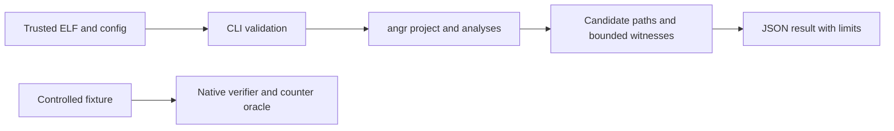
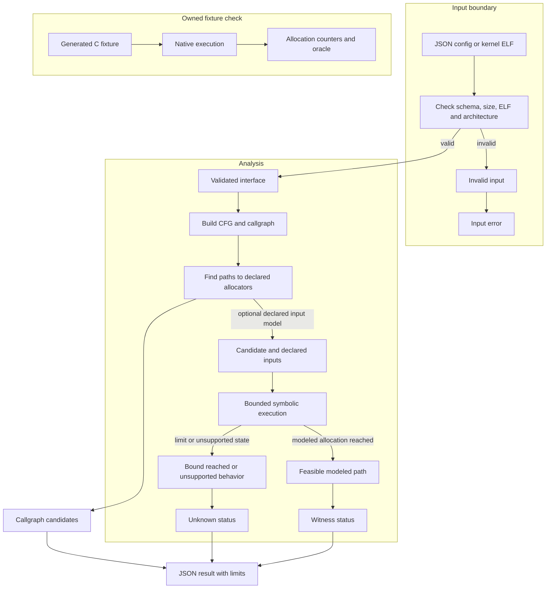

# Allocation Pattern Analyzer

Bounded static analysis for allocation-reaching paths in trusted ELF x86-64 programs, including Linux kernel images. The analyzer uses angr 9.2.207 to discover syscall and allocator symbols, index syscall-to-allocation callgraph candidates, and symbolically execute a declared entry point. It reports static candidates separately from satisfiable witnesses and unknown cases.

This repository retains the complete BSD-2-Clause angr source tree and Git history at released tag `v9.2.207` (`9037fb8c6ee4a2df61ba64b7a561373f5eb6b253`). The upstream license, copyright notices, and original README are preserved. The allocation analyzer, controlled fixtures, verification driver, and workflow are coursework additions; they do not replace or claim to reproduce the full angr project.

## Guide

[Implementation techniques](#implementation-techniques) ·
[Architecture and execution guide](#architecture-and-execution-guide) · [Run](#run) · [Research adaptation and measured scope](#research-adaptation-and-measured-scope) · [Verification](#verification)

## Architecture and execution guide

The repository extends angr with bounded analyses of trusted ELF inputs and controlled C fixtures. The inherited angr framework supplies project loading, [CFG](#control-flow-graph) construction and [symbolic execution](#symbolic-execution). Project code validates user configuration, finds call paths to known allocators, explores declared interfaces and classifies unresolved cases. Kernel scans report [syntactic candidates](#syntactic-candidate); they do not prove runtime allocation or a vulnerability.



Caption: offline analysis reports candidate paths and modeled witnesses, while the verifier separately runs only the project's owned harmless fixtures.



Caption: validation rejects malformed or out-of-scope inputs. Static candidates then feed bounded symbolic exploration, whose unknown outcomes remain explicit; native counters validate only generated fixture behavior.

| Subsystem | Responsibility and owned state | Source |
| --- | --- | --- |
| CLI and config validation | Validates exact JSON keys, symbols, ELF type and declared budgets. | [`allocation_analyzer/cli.py`](allocation_analyzer/cli.py) |
| Symbolic analyzer | Runs bounded exploration over a declared entry and input model. | [`allocation_analyzer/`](allocation_analyzer/) |
| Kernel candidate scan | Builds an x86-64 CFG and indexes paths from syscall symbols to known allocators. | [`allocation_analyzer/kernel_scan.py`](allocation_analyzer/kernel_scan.py) |
| Fixtures and oracle | Supplies harmless C programs and checks native allocation counters against expected behavior. | [`fixtures/`](fixtures/), [verification skill](.agents/skills/verify-allocation-pattern-analyzer/SKILL.md) |
| Evidence workflow | Runs fixture and kernel workflows with limits and retained receipts. | [Workflow](.github/workflows/allocation-pattern-checks.yml), [verification feature map](.agents/skills/verify-allocation-pattern-analyzer/features/) |

Execution journey:

1. The CLI reads a JSON config or kernel ELF path and checks fields, bounds, format and architecture before analysis.
2. angr loads the trusted binary. For kernel scan, CFGFast builds a graph and the scanner finds syscall entry symbols and known allocator symbols.
3. The scanner reports syntactic callgraph paths. Optional symbolic analysis explores a declared entry with bounded steps, states and time.
4. A feasible path under the modeled inputs becomes a [witness](#witness). A timeout, step limit, unsupported call or unconstrained successor remains an explicit [unknown](#unknown-status); no witness found is not proof of absence.
5. The separate verifier runs generated harmless C fixtures natively and compares allocation counters with an oracle. It does not execute analyzed kernel code.

| Choice in the current implementation | Practical rationale | Alternative and cost to reconsider |
| --- | --- | --- |
| Treat kernel scan as static callgraph candidate indexing. | It can cover many syscall entry points without claiming concrete execution. | Dynamic kernel execution needs controlled kernel infrastructure and a different trust boundary. |
| Require a bounded declared input model for symbolic exploration. | The result states which inputs and budgets produced a witness. | Unbounded exploration can stall or exhaust resources and still cannot model all system state. |
| Preserve unknown statuses for limits and unsupported behavior. | A missing witness under a limit is not evidence that a path is impossible. | Collapsing unknown into negative would overstate what the analyzer established. |
| Validate execution separately with owned fixtures and native counters. | The harmless C fixture supplies exact behavior the static model can be checked against. | Running arbitrary analyzed targets would cross the repository's permitted execution boundary. |

These rationales are inferred from the implementation; measurements and claims remain limited to their recorded inputs and model.

<a id="control-flow-graph"></a>

<details><summary>What is a control-flow graph?</summary>

A control-flow graph (CFG) represents possible function or basic-block transitions in a binary. The kernel scanner uses angr's CFGFast output to find graph paths from syscall symbols to allocator symbols.
</details>

<a id="syntactic-candidate"></a>

<details><summary>What is a syntactic candidate?</summary>

A syntactic candidate is a callgraph path from an entry point to a known allocator. It does not show that runtime conditions permit the path. The kernel scan labels such paths as candidates for that reason.
</details>

<a id="symbolic-execution"></a>

<details><summary>What is symbolic execution?</summary>

Symbolic execution follows program operations while representing selected inputs as symbolic values. Here, the analyzer uses declared function arguments and stops at configured state, step or time bounds.
</details>

<a id="witness"></a>

<details><summary>What is a witness?</summary>

A witness is an input assignment that reaches the modeled allocation event along an explored path. It is evidence about the modeled binary and interface, not proof of a kernel vulnerability or exploitability.
</details>

<a id="unknown-status"></a>

<details><summary>What does an unknown status mean?</summary>

An unknown status means the analysis could not decide the case within its model or budget. For example, a `step_limit` result says the configured exploration stopped before it found or ruled out a witness.
</details>

<a id="native-counter"></a>

<details><summary>What is a native counter oracle?</summary>

A native counter oracle compares actual allocation counters from a controlled fixture with expected counts. The verifier uses this for generated C programs; the oracle does not validate behavior in an arbitrary kernel image.
</details>

## Run

Use Python 3.11 and install the exact angr release with the dependencies in [`requirements-ci.txt`](requirements-ci.txt). On a clean Linux environment, install Rust toolchain `1.99.1`, then run:

```sh
python -m pip install pip==26.2.2
python -m pip install --constraint requirements-ci.txt --build-constraint requirements-ci.txt angr==9.2.207 unicorn==2.1.4
mkdir -p build
cc -nostdlib -Wl,-e,entry_direct -Wl,--build-id=none -fno-pie -no-pie -O0 fixtures/allocation_paths.c -o build/allocation_paths
python -I allocation_analyzer/cli.py analyze --config fixtures/direct.json
python -I allocation_analyzer/cli.py explore --config fixtures/conditional.json
python -I tests/test_config.py
python -I .agents/skills/verify-allocation-pattern-analyzer/scripts/verify.py --phase All
```

`analyze` emits JSON with syntactic call-graph candidates, feasible symbolic witnesses, allocator category, concrete declared-input values, constraints, executed block traces, and function chains reconstructed from those traces. Static candidate chains remain separate from the witness trace. `explore` compares seed-first selective symbolic exploration, seeded random concrete simulation, and bounded symbolic exploration. Input symbols and all budgets are validated; the binary must be a trusted ELF no larger than 256 MiB. See [`docs/development.md`](docs/development.md) for setup and result semantics, and [`docs/dependency-provenance.md`](docs/dependency-provenance.md) for release and native-build hashes.

`kernel-scan --binary vmlinux` discovers `__x64_sys_*` entrypoints and known slab or mapping allocator symbols from one x86-64 kernel ELF, then reports per-entry callgraph candidates. For example, `python -I allocation_analyzer/cli.py kernel-scan --binary /path/to/vmlinux --max-entries 5000`. `max-entries` applies after CFGFast and limits output entries, not CFG construction. Results without a syntactic path are marked unknown, not unreachable. An optional `--analyze-entry __x64_sys_name` reuses the bounded symbolic analyzer, but leaves the kernel syscall register frame, boot state, and external memory unmodeled; its outputs are exploratory model results, not real kernel witnesses or exploit inputs. The standalone CLI has no process-level time or memory limit. The pinned Ubuntu workflow builds official Linux 6.6 with `tinyconfig`, retains its source hash/config summary, and runs the scanner under a 900-second timeout and 8-GiB address-space limit. The [native kernel run](https://github.com/STEVVVU/allocation-pattern-analyzer/actions/runs/39722622608) built that official source and scanned all 440 discovered syscall entries, finding 231 syntactic allocation-path candidates across 139 entries and eight allocator symbols. [Retained output, config, provenance and verdict summaries](docs/evidence/linux-kernel-39722622608/) bind the result to the actual image hash. These counts are candidate coverage, not confirmed kernel witnesses, vulnerabilities or LASS bypasses.

## Research adaptation and measured scope

The seed-first strategy borrows Driller's selective concolic idea: run declared concrete inputs, identify uncovered edges that can reach a declared allocator, and prioritize symbolic execution there. This is a small angr-based adaptation, not a Driller implementation. Its concrete stage symbolically models concrete arguments inside angr; it is not native fuzzing. Native execution is performed separately by the verifier against the owned harmless C fixture.

The course project that motivates allocator-path analysis distinguishes allocation-reaching paths from mapping gadgets and notes that bounded basic-block exploration can miss paths. Its authors report that they did not find accessible controllable-address mapping gadgets. This project implements offline static candidate indexing for kernel ELF files and bounded symbolic exploration of declared interfaces; it does not identify a vulnerability, establish safety, bypass LASS, exploit Spectre, or measure a side channel. A feasible symbolic witness is a path under the modeled binary and declared interface. `no_witness_observed` means only that the configured bounded run found no witness. Time, state, step, unsupported-call, and unconstrained-successor cases remain explicitly unresolved.

References: [Berkeley CS 262A project report](https://people.eecs.berkeley.edu/~kubitron/courses/cs262a-F25/projects/reports/project1002_paper_ver2_39629115792957488818.pdf) and [Driller: Augmenting Fuzzing Through Selective Symbolic Execution](https://www.ndss-symposium.org/wp-content/uploads/2017/09/driller-augmenting-fuzzing-through-selective-symbolic-execution.pdf).

## Verification

The [hosted metrics run](https://github.com/STEVVVU/allocation-pattern-analyzer/actions/runs/39729506523) measured official Linux 6.1 and 6.6 tinyconfig images on separate four-vCPU Ubuntu runners, source `31d3bfa`, Python 3.11.9 and angr 9.2.207. Each cell is five fresh CLI processes after an unreported OS-cache warmup. All ten scans completed without errors/timeouts; each image's deduplicated candidate-set hash was identical across repeats.

| Trusted input | Scan median [range], seconds | Peak RSS, KiB | Entries scanned | Static candidate chains | Entries with no candidate, still unknown |
|---|---:|---:|---:|---:|---:|
| Linux 6.1 tinyconfig, 11,698,248 bytes | 89.336 [88.805–89.761] | 806,312 | 437/437 | 241 across 137 entries | 300 |
| Linux 6.6 tinyconfig, 9,635,384 bytes | 69.437 [69.319–69.872] | 796,536 | 440/440 | 231 across 139 entries | 301 |

These are different images on different runners, not a kernel-version speedup comparison. No kernel ground-truth feasibility labels exist, so candidate counts cannot yield precision/recall, confirmed allocations or a vulnerability claim. Separate profiles put about 98% of instrumented wall time in CFGFast; scan CPU time was close to wall time. The harness enforces 900 seconds and an 8 GiB address-space limit per subprocess; the standalone CLI still needs external limits.

Every repeated fixture pass retained ten cases and 233 exact native counter/oracle checks. Seven ordinary positive entrypoints produced validated witnesses; an additional known-positive loop was bounded out with `step_limit`. The infeasible fixture had a static candidate but no witness and zero native allocation counters. Unsupported indirect behavior remained `unconstrained_successor` and was intentionally not executed. Seeded random found no conditional witness in all five repeats on both runners, retaining its step-limit unknown; no miss is treated as proof of absence.

Strategy timings are descriptive: `explore` runs seed-first, seeded random and bounded symbolic in a fixed order on one shared CFG. For the 6.6 runner's conditional fixture, medians [range] were 27.788 [26.995–28.048] ms, 1,480.769 [1,464.533–1,483.608] ms and 7.630 [7.516–7.727] ms respectively; only the first and third found a witness. This is not a causal strategy-speedup result. Seed-first indirect witnesses deduplicated from four to two `(allocator, arguments)` tuples, and loop witnesses from two to one; different concrete inputs are not necessarily distinct semantic paths or gadgets.

[Curated samples, all strategy cells, input/config/source hashes and raw receipt hashes](docs/evidence/metrics-39729506523/measurement.json) preserve the evidence and cleanup result. Reproduce with `python -I .agents/skills/verify-allocation-pattern-analyzer/scripts/benchmark.py --run-id <fresh-id> --kernel-binary <trusted-vmlinux>` or the manual [metrics workflow](.github/workflows/metrics.yml). The [measurement contract](.agents/skills/verify-allocation-pattern-analyzer/features/metrics.md) retains the model and unknown-case limits.

The maintained [`verify-allocation-pattern-analyzer` skill](.agents/skills/verify-allocation-pattern-analyzer/SKILL.md) drives Launch, Doctor, Drive, Evidence, and Cleanup on generated fixtures and retains evidence after cleanup. Windows can compile and analyze the Linux ELF but cannot execute it natively. The pinned, read-only [Ubuntu workflow](.github/workflows/allocation-pattern-checks.yml) runs native counter validation and retains run evidence as a workflow artifact. It can be started with `workflow_dispatch`.

The inherited upstream CI workflow files are preserved byte-for-byte in [`archive/upstream-github-workflows/`](archive/upstream-github-workflows/); this project uses its focused workflow rather than the upstream workflows that call external services and reusable workflows.

The [native Ubuntu verification](https://github.com/STEVVVU/allocation-pattern-analyzer/actions/runs/39721132277) passed all ten analyzer cases, exact native counters for seven positive entrypoints, the infeasible zero-counter control, and the post-evidence failure/cleanup control. [Retained summaries](docs/evidence/linux-39721132277/) include raw artifact hashes and representative concrete witnesses. This earlier run verifies the controlled ELF fixture. The separate real-kernel scan above adds static candidate coverage without proving speculative-execution behavior.

## Implementation techniques

This section covers the owned offline analyzer, trusted ELF scan, generated harmless fixture, and maintained verification and metrics drivers. It excludes preserved upstream angr internals. The reasons for these implementation choices are inferred from the current code, not claims about the original authors' intent.

| Subsystem | Technique cards | Source |
| --- | --- | --- |
| Configuration and trusted ELF boundary | [Strict configuration and ELF validation](#technique-config-trust-boundary) | [`allocation_analyzer/cli.py`](allocation_analyzer/cli.py), [`allocation_analyzer/kernel_scan.py`](allocation_analyzer/kernel_scan.py) |
| Static syscall and allocation candidate scan | [CFG and callgraph candidate search](#technique-cfg-candidate-search) | [`allocation_analyzer/cli.py`](allocation_analyzer/cli.py), [`allocation_analyzer/kernel_scan.py`](allocation_analyzer/kernel_scan.py) |
| Bounded symbolic and concrete exploration | [Bounded symbolic execution](#technique-bounded-symbolic-execution), [coherent witness extraction and tracing](#technique-coherent-witness-tracing), [seed-first selective concolic exploration](#technique-seed-first-selective-exploration), [exploration controls](#technique-exploration-control-strategies) | [`allocation_analyzer/cli.py`](allocation_analyzer/cli.py), [`allocation_analyzer/kernel_scan.py`](allocation_analyzer/kernel_scan.py) |
| Harmless fixture and native validation | [Native counter instrumentation and independent oracle](#technique-native-counter-oracle) | [`fixtures/allocation_paths.c`](fixtures/allocation_paths.c), [verification driver](.agents/skills/verify-allocation-pattern-analyzer/scripts/verify.py) |
| Resource-bounded verification and retained evidence | [Bounded subprocesses and evidence ownership](#technique-bounded-process-evidence-lifecycle), [repeatable scan measurement](#technique-repeatable-scan-measurement) | [verification driver](.agents/skills/verify-allocation-pattern-analyzer/scripts/verify.py), [metrics driver](.agents/skills/verify-allocation-pattern-analyzer/scripts/benchmark.py), [CI workflow](.github/workflows/allocation-pattern-checks.yml) |

<a id="technique-config-trust-boundary"></a>

<details>
<summary>Strict configuration and trusted ELF validation</summary>

**Mechanism.** `load_config` requires an exact JSON key set, plain symbol names, unique integer inputs of supported widths, in-range seeds, declared allocator categories, and explicit step, state, time, seed, and trial limits. It resolves the binary relative to the config, checks file size and ELF magic, then `Analyzer` rejects non-AMD64 files and missing or imported symbols. The kernel path repeats its own file, size, format, architecture, and prefix checks.

**Example.** A config with an extra `shell` key or a seed wider than its declared 32-bit input is rejected before angr loads the binary.

**Why here.** These checks make the supported input contract explicit before analysis work begins.

**Tradeoffs.** ELF magic and size are preliminary format checks, not a safety guarantee for arbitrary inputs. The analyzer therefore assumes trusted binaries and does not execute them natively.

**Code and ownership.** [`allocation_analyzer/cli.py`](allocation_analyzer/cli.py#L60) `load_config` and [`Analyzer.__init__`](allocation_analyzer/cli.py#L129); [`allocation_analyzer/kernel_scan.py`](allocation_analyzer/kernel_scan.py#L28) `scan_kernel`. Extension.

</details>

<a id="technique-cfg-candidate-search"></a>

<details>
<summary>CFG and callgraph candidate search</summary>

**Mechanism.** The analyzer asks angr for a normalized `CFGFast` graph with data references, resolves declared entry and allocator symbols, and finds a shortest callgraph path for each allocator target. The kernel scanner gathers defined `__x64_sys_*` functions, intersects known allocator names with defined functions, sorts entries, and emits one candidate record per discovered entry. `max_entries` truncates the records only after CFG construction.

The analyzer asks angr for a normalized fast CFG with data references, resolves declared entry, syscall and allocator symbols, and searches graph paths from the entry to allocator targets. These are candidates for later modeling.

**Example.** A callgraph path from a declared syscall handler to `malloc` is reported as a static candidate. If `__x64_sys_fixture` reaches `kmalloc` through `slab_alloc`, the kernel scan reports that graph route as a syntactic candidate.

**Why here.** Graph search narrows the symbolic execution to declared allocation-reaching routes. The graph index summarizes many entry-to-allocator routes before the more expensive, bounded symbolic stage.

**Tradeoffs.** An incomplete or indirect callgraph can miss paths; a graph path alone does not prove feasible input values. A shortest graph route is only one syntactic path and may be infeasible even when a longer route is feasible; no path found remains unknown rather than unreachable.

**Code and ownership.** [`allocation_analyzer/cli.py`](allocation_analyzer/cli.py#L153) constructs CFGFast in `Analyzer.build_cfg` and searches candidates in [`Analyzer.candidates`](allocation_analyzer/cli.py#L157); [`allocation_analyzer/kernel_scan.py`](allocation_analyzer/kernel_scan.py#L28) `scan_kernel`. Mixed: analyzer extension over angr and NetworkX path search.

</details>

<a id="technique-bounded-symbolic-execution"></a>

<details>
<summary>Bounded symbolic execution</summary>

**Mechanism.** The analyzer creates fixed-width symbolic bitvectors for declared inputs and starts an angr call state at the configured entry. A heap frontier explores successors until the step budget, created-state limit, or elapsed-time budget is reached. Allocator states are checked for satisfiability; execution errors, unconstrained successors, solver errors, and exhausted limits remain explicit unknowns. A witness can coexist with unknown paths.

The analyzer creates symbolic bitvectors for declared inputs, starts an angr state at the configured entry, and explores states under step, state-count and time budgets. Reaching a modeled allocation produces a witness; exhausted or unsupported paths remain unknown.

**Example.** A symbolic request length can satisfy a branch guarding an allocation call. In `entry_conditional`, a 32-bit symbolic value can satisfy the equality guarding `mapping_alloc`; a one-step loop run instead reports `step_limit`.

**Why here.** The bounded run distinguishes feasible modeled paths from mere CFG candidates. It tests whether a graph candidate has a feasible path for the declared interface without turning open-ended exploration into an unbounded process.

**Tradeoffs.** Bounds and unsupported behavior can leave results unknown. A witness establishes feasibility in angr's model, not on a native execution. `no_witness_observed` means only that this bounded run found none; it is not a proof of absence.

**Code and ownership.** [`allocation_analyzer/cli.py`](allocation_analyzer/cli.py#L175) `Analyzer._symbolic_run`; the optional kernel entry adapter is [`allocation_analyzer/kernel_scan.py`](allocation_analyzer/kernel_scan.py#L115) `_analyze_entry`. Mixed: project policy and result labels over angr and Claripy.

</details>

<a id="technique-coherent-witness-tracing"></a>

<details>
<summary>Coherent witness extraction and executed-path tracing</summary>

**Mechanism.** At a satisfiable allocator state, the analyzer concatenates all symbolic arguments and asks the solver for one model, then splits that packed integer back into the declared widths. This keeps correlated arguments from different satisfying models from being combined. It separately derives the function chain from the state's visited basic blocks and records the block trace, constraints, and whether both entry and allocator were recovered.

**Example.** For the correlated fixture, `left=7, right=17` is not accepted by the native oracle; one joint model must satisfy either allowed pair in the C condition.

**Why here.** The reported inputs and route need to describe the same solver state that reached the allocator.

**Tradeoffs.** The concatenated model chooses one satisfying assignment, not all assignments. Trace recovery can be incomplete when a block or function cannot be mapped through the CFG.

**Code and ownership.** [`allocation_analyzer/cli.py`](allocation_analyzer/cli.py#L230) extracts one packed Claripy model and [`Analyzer._call_trace`](allocation_analyzer/cli.py#L302) reconstructs the route. Mixed: project report assembly over angr history and Claripy models.

</details>

<a id="technique-seed-first-selective-exploration"></a>

<details>
<summary>Seed-first selective concolic exploration</summary>

**Mechanism.** The `explore` mode first runs each configured seed with concrete bitvectors and records visited blocks and edges. It computes graph nodes that can reach known allocator targets, then gives symbolic successors higher queue priority when they use an uncovered edge and remain in that target-reachable set. The concrete and symbolic stages consume the configured step and time budgets for this strategy.

**Example.** Seeds that follow the false branch of `entry_conditional` leave its allocation edge uncovered; symbolic exploration prioritizes that route if the CFG says it can reach the allocator.

**Why here.** Concrete paths provide observed edge coverage that can guide symbolic work toward allocation-reaching branches.

**Tradeoffs.** Priority is a heuristic over CFG reachability and does not establish feasibility. The method uses the supplied seeds, not mutation-based fuzzing, and can spend its bounded budget on other paths.

**Code and ownership.** [`allocation_analyzer/cli.py`](allocation_analyzer/cli.py#L332) `Analyzer._concrete_run` and [`Analyzer.explore`](allocation_analyzer/cli.py#L410). Mixed: project selection policy over angr execution and NetworkX graph analysis.

</details>

<a id="technique-exploration-control-strategies"></a>

<details>
<summary>Deterministic random and plain-symbolic controls</summary>

**Mechanism.** In the same `explore` invocation, seeded random concrete inputs use a local `random.Random` initialized from the config seed, while plain bounded symbolic exploration starts without seed-derived edge priorities. Both are reported beside seed-first exploration with separate steps, witnesses, and unknown outcomes. The CLI shares one CFG across the strategies and records their fixed execution order.

**Example.** The verifier checks that the seeded-random conditional run spends its block budget without a witness while seed-first and plain symbolic runs find the modeled allocation branch.

**Why here.** These controls expose what the implementation observed under configured inputs and budgets.

**Tradeoffs.** Strategies are run sequentially and share setup; timings cannot show causal superiority. The controls demonstrate fixture behavior, not generalized search quality.

**Code and ownership.** [`allocation_analyzer/cli.py`](allocation_analyzer/cli.py#L410) `Analyzer.explore`; [`verify.py`](.agents/skills/verify-allocation-pattern-analyzer/scripts/verify.py#L207) `Run.drive` checks the fixture controls. Extension.

</details>

<a id="technique-native-counter-oracle"></a>

<details>
<summary>Native counter oracle</summary>

**Mechanism.** The owned C fixture increments `volatile` slab and mapping counters at allocator stubs. On supported Linux runs, the driver executes the native fixture for each reported input and compares the exact counter object with a separately written Python oracle. It also requires a positive counter for reported witnesses and checks zero counters for the deliberately infeasible input. The unsupported indirect-call case is not run natively.

The verification driver compiles and runs only the owned C fixtures with instrumented allocation counters, then compares observed paths and counts with analyzer output. Native results are reported separately from symbolic witnesses.

**Example.** The conditional fixture is run with inputs that do and do not reach its allocation branch. A conditional witness is passed to the fixture runner; the observed `mapping` counter must equal the independent oracle's expected count.

**Why here.** A native oracle checks the model against a real execution of controlled code without executing arbitrary analyzed ELF files.

**Tradeoffs.** Fixture agreement does not validate arbitrary ELF targets or kernel images. Windows records native validation as not run because it cannot execute this Linux ELF.

**Code and ownership.** [`fixtures/allocation_paths.c`](fixtures/allocation_paths.c#L10) `slab_count`, `mapping_count`, and allocator stubs; [`verify.py`](.agents/skills/verify-allocation-pattern-analyzer/scripts/verify.py#L166) `Run.native_oracle_check` and `Run.concrete_oracle`. Extension.

</details>

<a id="technique-bounded-process-evidence-lifecycle"></a>

<details>
<summary>Bounded subprocesses and evidence ownership</summary>

**Mechanism.** The verification driver gives each run a unique scratch directory, records commands and output in a transcript, and writes stage events to JSON. It runs child commands with explicit timeouts; the kernel verifier additionally applies an address-space limit on POSIX. Cleanup deletes only the run-owned scratch ELF files and checks that transcript and evidence survive, including the injected-failure path. The CI job preserves run records as an artifact.

**Example.** Kernel scan runs under a 900-second timeout and an 8-GiB address-space limit in the hosted verifier; timeout evidence is written before the failure is raised.

**Why here.** Bounded analysis can consume substantial resources, and retained run-local records make success, failure, and cleanup inspectable.

**Tradeoffs.** The standalone analyzer has no process-level timeout or memory cap. Address-space limiting is POSIX-only; Windows reports no native fixture execution.

**Code and ownership.** [`verify.py`](.agents/skills/verify-allocation-pattern-analyzer/scripts/verify.py#L43) `Run.command` and [`Run.cleanup`](.agents/skills/verify-allocation-pattern-analyzer/scripts/verify.py#L372); [workflow](.github/workflows/allocation-pattern-checks.yml#L19) sets the job limit and uploads evidence. Extension.

</details>

<a id="technique-repeatable-scan-measurement"></a>

<details>
<summary>Warmup, repeat, and candidate-fingerprint measurement</summary>

**Mechanism.** The metrics driver records environment and input hashes, runs one unreported warmup, then launches five fresh scan processes. Each repeat requires all discovered syscall entries to be scanned, rejects duplicate candidate tuples, and checks a stable hash of the complete candidate set. The profile run is retained separately from timed samples; native fixture labels and unknown kernel outcomes are also preserved.

**Example.** Each kernel sample contains elapsed time, peak RSS, CPU time, entry and candidate counts, unknown-entry count, and a candidate-set hash.

**Why here.** Repeats and output fingerprints help distinguish reproducible scan output from a single run while keeping fixture ground truth separate from kernel candidates.

**Tradeoffs.** A stable candidate set is not evidence that candidates are feasible. Strategy order is fixed and CFG setup is shared, so timings do not establish causal performance differences.

**Code and ownership.** [metrics driver](.agents/skills/verify-allocation-pattern-analyzer/scripts/benchmark.py#L31) `measure` and [`main`](.agents/skills/verify-allocation-pattern-analyzer/scripts/benchmark.py#L64). Extension.

</details>
